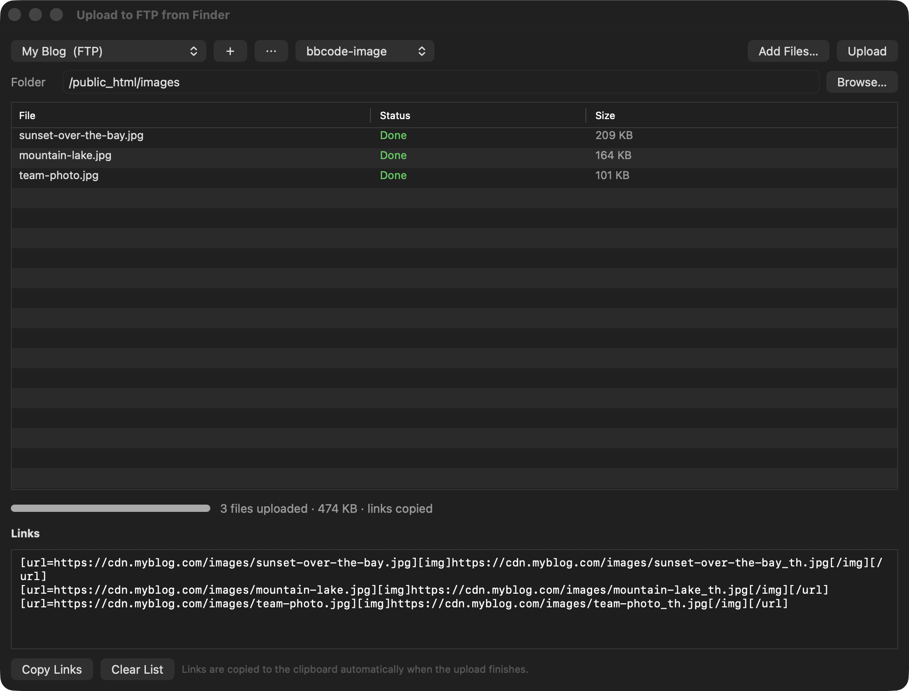
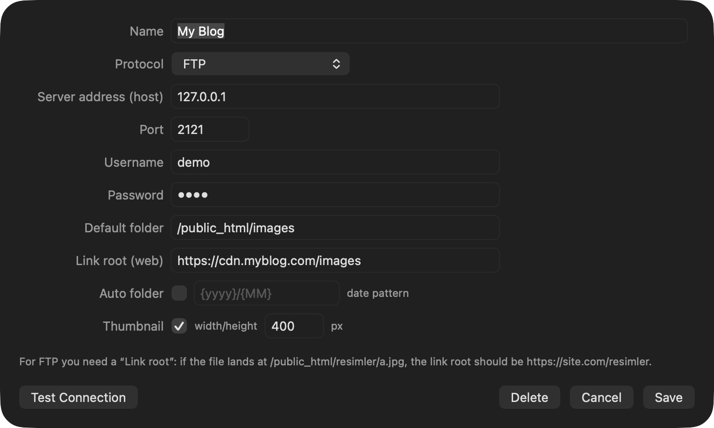
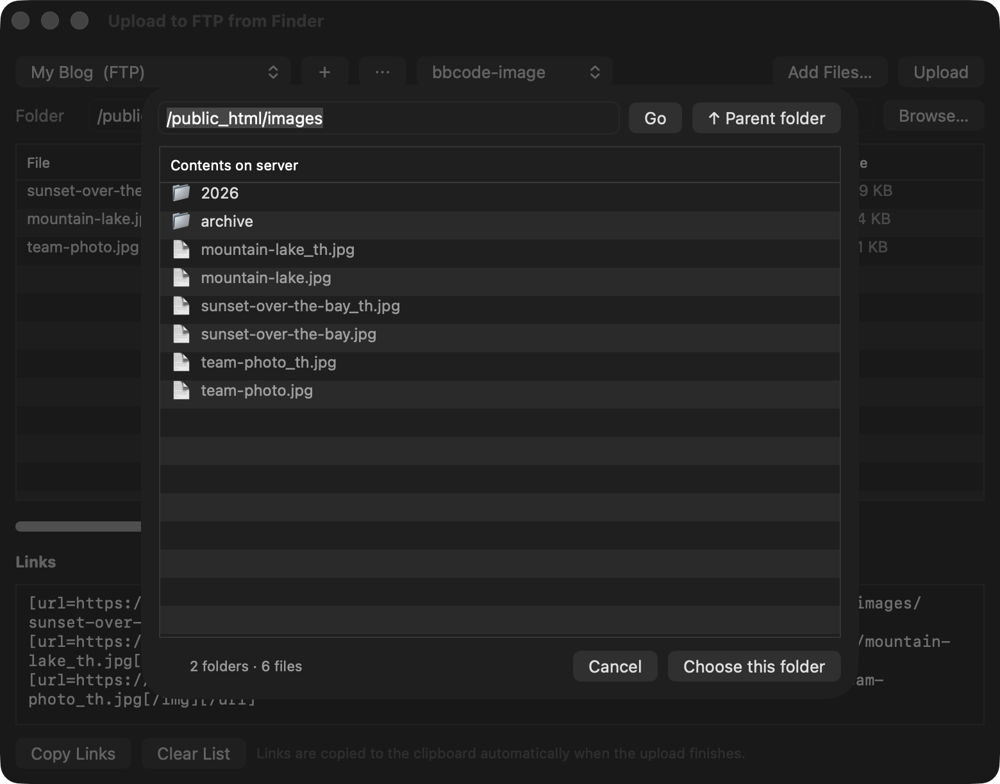
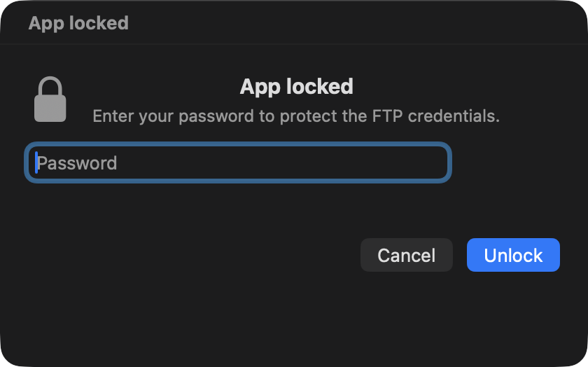

<div align="center">

# Upload to FTP from Finder

**Right-click any file in Finder → upload it to your server → the link is already in your clipboard.**

A tiny macOS menu bar app for people who upload screenshots and photos all day and are tired of opening a full FTP client to move three files.


[Download](#install) · [Features](#features) · [Screenshots](#screenshots) · [Build from source](#build-from-source)

</div>

---

## Why

Uploading "just three pictures" usually means: open a heavy FTP app, type the host, log in, navigate to the right folder, drag, wait, then copy each URL by hand.

This app removes all of that. Select the files in Finder, right-click, pick your server — the upload starts and the **BB-Code / HTML / Markdown links land in your clipboard**.



## Features

**Finder integration**
- Right-click menu: *Upload to FTP from Finder ▸ server ▸ Upload here / Choose folder…*
- Also works from the menu bar, drag & drop onto the window, and "Open With"
- Folder selection: browse the server, pick the exact directory before uploading
- Optional date-based subfolders (`{yyyy}/{MM}`)

**Protocols**
- FTP, FTPS (explicit + implicit)
- HTTP POST (multipart form) for custom endpoints — links are extracted from the server response with a preset or a custom regex
- SFTP: planned (macOS' built-in curl has no SSH support)

**Files**
- Batch upload queue with per-file progress, cancel, retry
- Automatic thumbnails (`_th` suffix) and optional downscaling before upload
- Turkish characters and spaces handled correctly (NFC + percent-encoding)

**Links**
- Templates: plain URL, BB-Code, BB-Code image, HTML, HTML image, Markdown, Markdown image
- Custom templates with `{url}`, `{thumb}`, `{filename}`, `{size}`, `{yyyy}` …
- Everything copied to the clipboard automatically

**Privacy & control**
- Optional password lock: never / on launch / on every upload / on every action
- Passwords hashed with PBKDF2-HMAC-SHA256 (120k rounds, random salt)
- English + Turkish UI (system language or manual, more languages are one dictionary away)
- No analytics, no telemetry, no account

## Screenshots

| Add a server | Choose a folder on the server |
|---|---|
|  |  |

| Password lock |
|---|
|  |

## Install

### DMG (recommended)

1. Download **`UploadToFTP-0.1.0.dmg`** from [Releases](../../releases/latest)
2. Open it and drag **Upload to FTP from Finder** into *Applications*
3. First launch: **right-click the app → Open** (the build is ad-hoc signed, not notarized yet)

Then enable the Finder extension:

```sh
# one-time, enables the right-click menu
pluginkit -e use -i com.mcb.upload.FinderSync
killall Finder
```

If the menu still doesn't appear: **System Settings › General › Login Items & Extensions › Added Extensions** → enable **Upload to FTP from Finder**.

### ZIP

Download **`UploadToFTP-0.1.0.zip`**, unzip, move the app to *Applications*, then run the same two commands above.
The zip also contains the `mcb` command line tool.

> **Gatekeeper note:** releases are ad-hoc signed (`codesign -`). macOS will warn on the first launch — right-click → *Open* once. If it still complains:
> `xattr -dr com.apple.quarantine "/Applications/Upload to FTP from Finder.app"`

## Add your server

Menu bar **▲** → **Add Server…** (⌘N), or click **+** in the main window.

| Field | Example |
|---|---|
| Name | `My Blog` |
| Protocol | FTP / FTPS / HTTP POST |
| Server address (host) | `ftp.example.com` |
| Port | `21` (auto-filled per protocol) |
| Username / Password | your FTP account |
| Default folder | `/public_html/images` |
| Link root (web) | `https://example.com/images` |
| Auto folder | `{yyyy}/{MM}` (optional) |
| Thumbnail | on, 400 px |

**Link root** is the web address that corresponds to your default folder — links are built from it:

```
file uploaded to  /public_html/images/2026/11/photo.jpg
link root         https://example.com/images
→ link            https://example.com/images/2026/11/photo.jpg
```

Use **Test Connection** to verify credentials and folder access before saving.

## Finder usage

1. Select one or more files (or a folder — its contents are added) in Finder
2. Right-click → **Upload to FTP from Finder**
3. Pick a server:
   - **Upload here** → the server's default folder
   - **Choose folder…** → the app opens so you can browse the server and pick a directory
4. Links are copied to the clipboard when the upload finishes

## Password lock

Menu bar **▲** → **Security & Language…**

| Option | Behaviour |
|---|---|
| Never | no password |
| When the app opens | asks once per launch |
| On every upload | asks before each upload |
| On every action | asks before upload, folder browsing and server editing |

The lock screen appears before anything sensitive happens; wrong password does nothing. `⌘L` locks the session manually.

> **Security honesty:** the *app* password is properly hashed (PBKDF2), but the **FTP passwords are still stored in plain text** in `~/Library/Application Support/MCBUpload/servers.json` (permissions `0600`). Moving them to the macOS Keychain is the next security milestone.

## Command line

```sh
mcb upload photo.jpg --server "My Blog" --format bbcode-image
mcb upload *.png --server "My Blog" --dir /public_html/2026 --format markdown
mcb ls "My Blog" /public_html          # list folders on the server
mcb servers                           # list configured servers
mcb test "My Blog"                    # test the connection
mcb password set "secret" --policy every-upload
mcb import-filezilla                  # import sites from FileZilla
```

## Build from source

No Xcode required — only the Command Line Tools (Swift 5.9+).

```sh
git clone https://github.com/raca12/upload-to-ftp-from-finder.git
cd upload-to-ftp-from-finder
./build.sh                    # core + CLI + app + Finder extension
./build.sh --with-selftest
.build/manual/selftest        # 58 checks
./tools/install-extension.sh  # install to /Applications and enable the extension
```

`tools/build-release.sh` produces `dist/` with:

```
UploadToFTP-0.1.0.dmg
UploadToFTP-0.1.0.zip
SHA256SUMS.txt
```

Everything is built by hand: the `.appex` is compiled with `swiftc`/`clang`, signed ad-hoc, registered with `lsregister` + `pluginkit`. That is why the repo has no `.xcodeproj`.

### Layout

```
Sources/
  MCBUploadCore/          # shared engine (also used by the extension)
    Models/               # server profiles, upload results
    Transport/            # curl-based transport (credentials via stdin)
    Upload/               # upload engine, path tools, connection test, directory lister
    Images/               # thumbnails & resizing (ImageIO)
    Links/                # link templates
    Store/                # servers.json + data-dir migration
    Security/             # PBKDF2 password + lock policy
    Localization/         # TR/EN dictionary
    Bridge/               # Finder extension → app request inbox
    Import/               # FileZilla sitemanager.xml
  MCBUploadApp/           # menu bar app + main window (AppKit)
  MCBUploadFinderSync/    # Finder Sync extension (.appex)
  mcb/                    # CLI
  selftest/               # dependency-free test runner
tools/
  mock_ftp_server.py      # local FTP server for testing
  mock_upload_server.py   # local HTTP upload endpoint
  install-extension.sh
  build-release.sh
```

## Roadmap

- [ ] SFTP (libssh2 / swift-nio-ssh)
- [ ] S3, Cloudflare R2, WebDAV
- [ ] Keychain for FTP credentials
- [ ] Upload from clipboard (screenshots)
- [ ] Developer ID signing + notarization (needs an Apple Developer account)
- [ ] More languages (German, Spanish)

## Credits

Feature set inspired by [Rightload](https://rightload.org/), a Windows uploader from 2010 that is no longer available for macOS.
This project is an independent clean-room implementation — no code or affiliation.

Turkish UI included: *Ayarlar → Dil → Türkçe*.

## License

[MIT](LICENSE) © 2026 MCB
